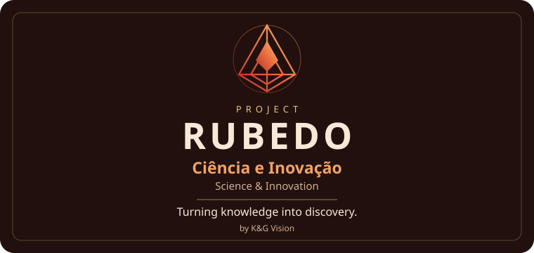

<p align="center"></p>

# Project Rubedo — Ciência e Inovação

<!-- kg-personal-portfolio-v1 -->

**Idealizador / Creator:** [Kaio Gabriel da Silva — KG Professional Portfolio 1.0](https://kgasil.github.io/portfolio/) · [GitHub](https://github.com/Kgasil) · [LinkedIn](https://www.linkedin.com/in/kaio-gabriel-da-silva). Portfólio pessoal independente do projeto / Personal portfolio separate from this project.

<!-- kg-current-training -->
**Formação e trajetória do idealizador / Creator's education and experience:** [Currículo público atualizado / Updated public résumé](https://kgasil.github.io/portfolio/resume.html) · [Portfólio / Portfolio](https://kgasil.github.io/portfolio/). A formação pessoal é independente dos produtos e materiais do projeto / Personal training is independent of project products and materials.


**Science & Innovation · Ciência e Inovação**  
*Turning knowledge into discovery.*  
*by K&G Vision*

> **Marco 01 — Rubedo Public Lab 1.0 / edição pública inicial experimental.** Integra o ecossistema GRAAL, preservando os marcos anteriores. Não é empresa constituída, laboratório certificado, serviço comercial ou solução industrial validada.

[Site oficial](https://kgasil.github.io/rubedo/) · [Português](#português) · [English](#english) · [Modelos](docs/modelos.md) · [Planejamento](docs/planejamento.md) · [Publicação](docs/publicacao.md)

## Research Workspace 1.0 — 26/11/2026

Lançamento público experimental aprovado pelo idealizador após testes manuais relatados. Oito modelos científicos (R01–R04, R06–R09), caderno R05, biblioteca de oito experimentos e Research Studio com exportação JSON/TXT. / Experimental public release approved by the maintainer following reported manual testing. Eight scientific models, research notebook, eight experiment protocols and results studio. Mini Lab and Mini Extension are now 1.0.0; manual installation only. Independent automated regression results for the latest revision are not confirmed. Not validated for industrial decisions or certified research.

[Comunicado / Announcement](docs/research-workspace-v1.0.md)

## Português

Rubedo é uma frente de pesquisa científica aplicada, matemática, simulação computacional, pesquisa operacional e engenharia de produção. Sua missão é transformar perguntas em modelos, experimentos reproduzíveis e evidências com hipóteses e limitações explícitas. A iniciativa K&G Vision é individual hoje; no futuro, suas frentes poderão operar com autonomia e coordenação comum. Rubedo não substitui Genesis (estudo), Argus (engenharia e segurança de IA), Aeris (produtividade) ou Lilium (inteligência empresarial).

## Acesso rápido / Quick access

O simulador da página inicial agora permite continuar o cenário de ciclo e demanda no Mini Lab por um link com valores fictícios no fragmento da URL, sem envio desses valores ao servidor. / The landing demo can transfer a synthetic cycle and demand scenario into the Mini Lab via a URL fragment, without sending the values to the server.

[**Experimente o simulador na página inicial**](https://kgasil.github.io/rubedo/#experimente) · [**Instalação manual**](https://kgasil.github.io/rubedo/#instalar). O Mini Lab e a extensão 1.0.0 incluem as quatro ferramentas, perdas de disponibilidade e qualidade e cobertura de demanda. Não há publicação nas lojas Chrome/Edge.

| Recurso / Resource | Descrição / Scope |
| --- | --- |
| [Site institucional / Website](index.html) | Missão, metodologia, identidade, instalação, roadmap e ecossistema / Mission, method, installation, roadmap and ecosystem |
| [Research Workspace](research/index.html) | Oito modelos de pesquisa e caderno científico / Eight research models and notebook |
| [Mini Lab 1.0.0](mini/index.html) | Quatro ferramentas de cálculo / Four calculation tools |
| [Mini Extension 1.0.0](extension/README.md) | Quatro ferramentas locais / Four local tools |
| [ZIP de instalação / Installation ZIP](downloads/Rubedo-Mini-v1.0.0-install.zip) | Manifest V3, ícones e tutorial / Manifest V3, icons and tutorial |
| [Resultados reproduzíveis / Reproducible results](examples/reference-results.json) | Cinco casos de referência sintéticos / Five synthetic reference cases |

## Research Workspace — 1.0 (experimental)

| ID | Modelo / Model | Entrega / Output |
| --- | --- | --- |
| R01 | Sensibilidade de capacidade / Capacity sensitivity | Três cenários de ciclo, produção estimada / Three cycle scenarios and estimated output |
| R02 | Fila analítica M/M/1 / Analytical queue | Utilização, espera e permanência em regime estacionário / Utilization, wait and sojourn in steady state |
| R03 | Simulação estocástica M/M/1 / Stochastic simulation | Sementes, aquecimento, repetições, médias, gráfico e JSON / Seeds, warmup, replications, means, chart and JSON |
| R04 | Otimização contínua / Continuous optimization | Dois produtos, dois recursos, solução por vértices, folgas, região viável e JSON / Two products, two resources, vertex solution, slack, feasible region and JSON |
| R05 | Caderno de pesquisa / Research notebook | Protocolo JSON, exportação e restauração explícita / Explicit protocol export and restore |

| R06 | Precisão de medição / Measurement precision | Média, desvio amostral e erro padrão / Mean, sample deviation and standard error |
| R07 | Monte Carlo triangular / Triangular Monte Carlo | Semente, percentis e frequência de meta / Seed, quantiles and target frequency |

R06 e R07 são adições experimentais ao Workspace; testes adicionados, execução atual ainda não confirmada. / Experimental additions; new test execution not yet confirmed.

| R08 | Regressão linear / Linear regression | Pearson, R², RMSE, resíduos e JSON |
| R09 | Confiabilidade / Reliability | Série, paralelo, MTTF e JSON |


## Experiment Library & Research Studio

[8 protocolos / 8 protocols](https://kgasil.github.io/rubedo/research/#biblioteca) · [Central de resultados / Results studio](https://kgasil.github.io/rubedo/research/#studio). Até 100 registros manuais em memória, comparação por modelo, métrica e unidade idênticos, exportação JSON/TXT. / Up to 100 manually entered in-memory records, comparison by matching model, metric and unit, JSON/TXT export. Dados sintéticos; validação pendente / Synthetic data; validation pending.

## Mini Edition — 1.0.0

| Ferramenta / Tool | Web | Extensão / Extension |
| --- | --- | --- |
| Capacidade estimada / Estimated capacity | Sim / Yes | Sim / Yes |
| Gargalos de linha serial / Serial line bottlenecks | Sim / Yes | Sim / Yes |
| Comparação descritiva / Descriptive comparison | Sim / Yes | Sim / Yes |
| Takt e demanda / Takt and demand | Sim / Yes | Sim / Yes |

Interfaces PT/EN; exemplos fictícios; cópia manual e exportação JSON dos resultados calculados. Não há conta, IA conectada, telemetria, leitura automática de páginas, permissões especiais ou armazenamento persistente. Exportações contêm as entradas informadas: use dados sintéticos ou autorizados. Comparações descritivas não demonstram significância, causalidade ou melhoria.

### Executar o site / Run the site

Extraia o pacote completo. Na raiz, execute `python -m http.server 8000 --bind 127.0.0.1` e abra `http://127.0.0.1:8000/`. Não é necessário backend. O servidor estático aproxima a experiência do GitHub Pages. / Extract the package, run the command from its root and open the local URL. No backend is required.

### Instalação manual da extensão

1. Baixe e extraia o [ZIP de instalação](downloads/Rubedo-Mini-v1.0.0-install.zip) em pasta permanente.
2. No computador, abra `chrome://extensions/` ou `edge://extensions/`.
3. Ative o modo desenvolvedor, se permitido, e selecione **Carregar sem compactação**.
4. Selecione a pasta extraída que contém `manifest.json`, não o ZIP.
5. Abra Rubedo Mini e teste os exemplos fictícios. Para atualizar, substitua os arquivos e clique em Recarregar; para remover, clique em Remover.

[Guia detalhado](extension/README.md) · [SHA-256](downloads/SHA256SUMS.txt). Não contorne políticas administrativas. A interface foi testada isoladamente, mas a instalação real em Chrome/Edge permanece pendente. Não está nas lojas.

## English

Rubedo is an applied research and computational engineering initiative within K&G Vision, focused on mathematical modeling, operations research, scenario analysis and reproducible experiments. The Research Workspace includes capacity sensitivity, an analytical M/M/1 queue, seeded stochastic queue simulation, a continuous two-variable linear program and a local JSON research notebook. The Mini Lab offers four tools and the extension four. All are exploratory prototypes, not validated industrial decisions, commercial services or accredited research. See [model assumptions](docs/modelos.md) and [experiment protocols](docs/experimentos.md).

**Manual extension installation:** Extract the installation ZIP. On desktop Chrome or Edge, open the extensions page, enable Developer mode where permitted, select Load unpacked, and choose the extracted folder containing manifest.json. Reload to update; Remove to uninstall. Manual acceptance in the actual extension environment is pending.

## Desenvolvimento e validação / Development and validation

```sh
node tests/mini.test.js
node tests/research.test.js
node tests/advanced.test.js
node tests/scenario.test.js
node tests/precision.test.js
node tests/monte.test.js
node tests/statistics.test.js
node scripts/reference_results.js --check
python3 tests/check_package.py
```

Para reconstruir o ZIP e seu hash após uma alteração intencional da extensão, use `python3 scripts/package_extension.py`. Para regenerar os casos de referência, use `node scripts/reference_results.js` e revise as diferenças. Não atualizar os resultados esperados para esconder erros. O CI preparado inclui sintaxe, testes, referência, pacote e navegador Playwright. Consulte [validação local](docs/validacao-local.md) e [histórico](CHANGELOG.md). A [revisão técnica que fundamenta a edição inicial 1.0](https://github.com/Kgasil/rubedo/actions/runs/45749793253) passou em 84 testes de regras, 43 verificações de interface via HTTP, cinco casos reproduzíveis e integridade do ZIP. A numeração 1.0 é do Public Lab; Research Workspace chega à edição experimental 1.0; Mini Lab e Mini Extension chegam à versão 1.0.0. A instalação nativa ainda depende de aceitação manual. / See GitHub Actions for current CI status.

## Ecossistema GRAAL / GRAAL ecosystem

<p align="center"><a href="https://kgasil.github.io/"></a></p>

O escudo institucional mantém o topo roxo e rosa, o núcleo branco e a ponta inferior laranja do Rubedo. / The institutional shield preserves the purple and pink top, white core and Rubedo’s orange lower tip.

[Escudo / Shield](https://github.com/Kgasil/kgasil.github.io/blob/main/assets/kg-symbol.svg)

| Projeto | Missão | Acesso |
| --- | --- | --- |
| K&G Vision | Coordenação e direção / Coordination | [Portal](https://kgasil.github.io/) |
| Genesis | Sabedoria e Aplicação / Learn | [Site](https://kgasil.github.io/genesis/) |
| Rubedo | Ciência e Inovação / Discover | [Site](https://kgasil.github.io/rubedo/) |
| Argus | Segurança e Desenvolvimento / Build | [Site](https://kgasil.github.io/argus/) |
| Aeris | Eficiência e Simplicidade / Simplify | [Site](https://kgasil.github.io/aeris/) · [Desktop 1.1.0 RC1 — prévia experimental](https://kgasil.github.io/aeris/#instalacao) · [Extension 1.0.0](https://kgasil.github.io/aeris/extension-preview.html) |
| Lilium | Estratégia e Evolução / Evolve | [Site](https://kgasil.github.io/lilium/) |

A ordem do ecossistema forma GRAAL. [Arquitetura organizacional](docs/ecossistema.md). Preservar versões, funcionalidades e marcos anteriores. A identidade é conceitual e a disponibilidade comercial do nome não foi verificada.

[](https://kgasil.github.io/) **GRAAL · Marco 01** — identidade integrada / integrated identity.


**[Central de distribuição GRAAL / GRAAL distribution center](https://kgasil.github.io/distribuicao.html)** — versões, canais oficiais, limitações e estado de segurança / versions, official channels, limitations and security status.
